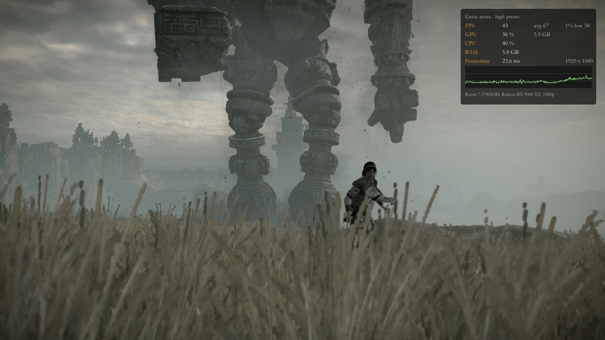
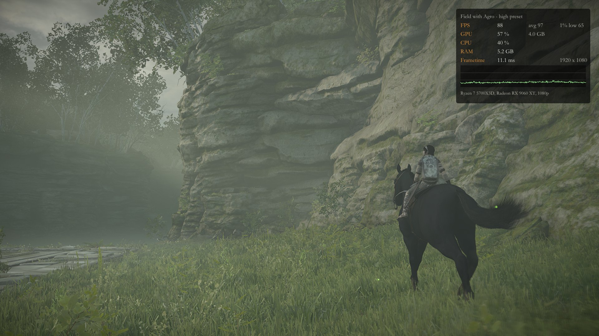
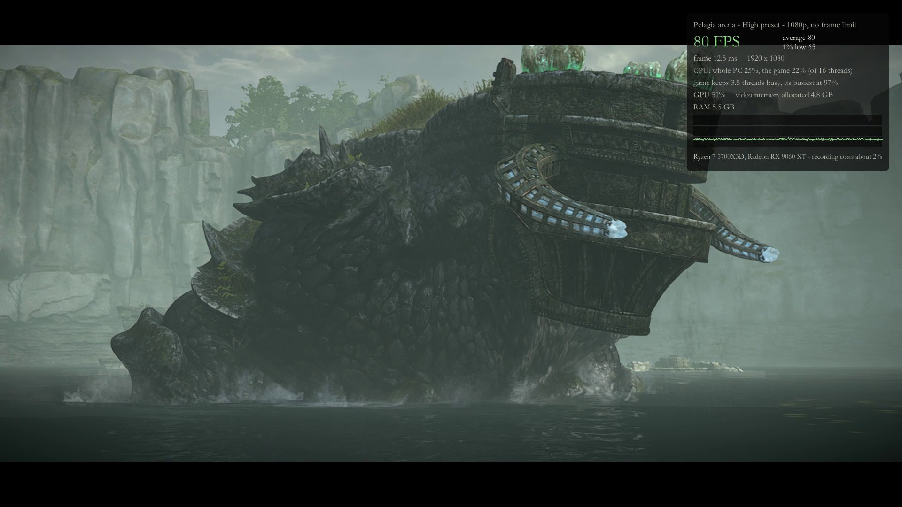
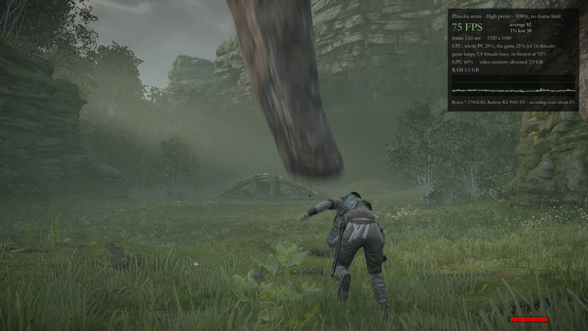
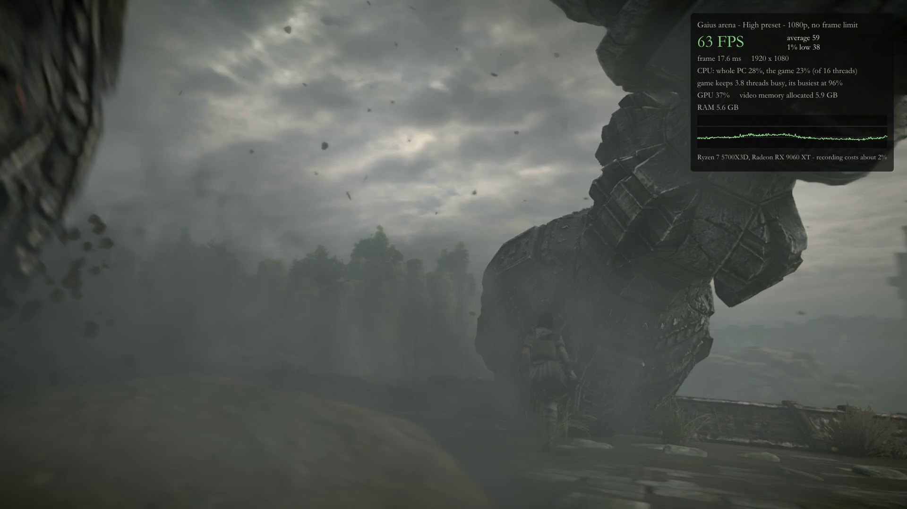
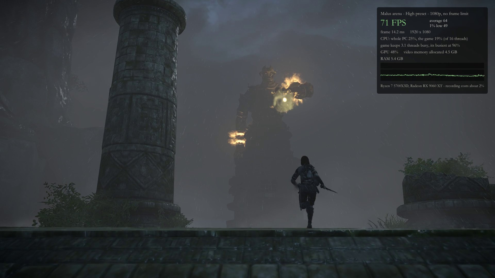
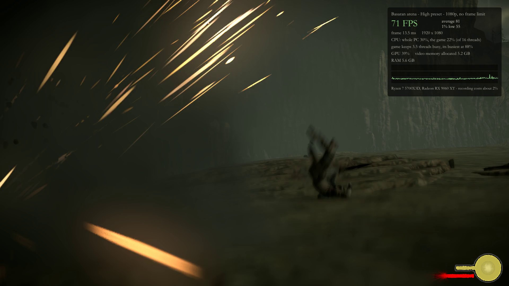
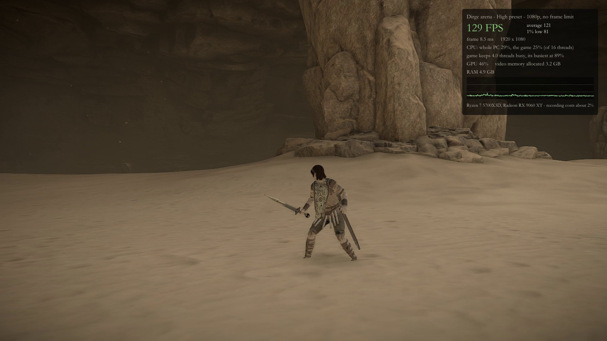
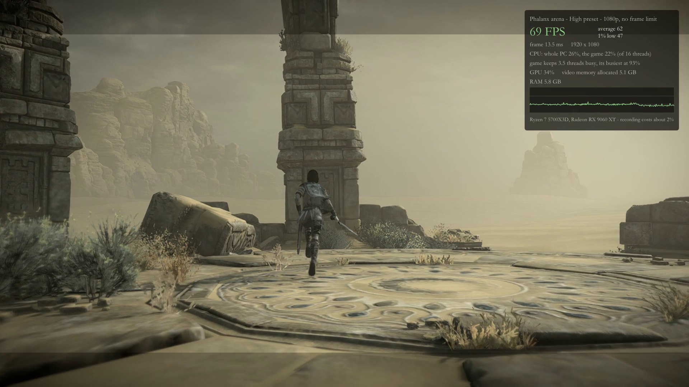
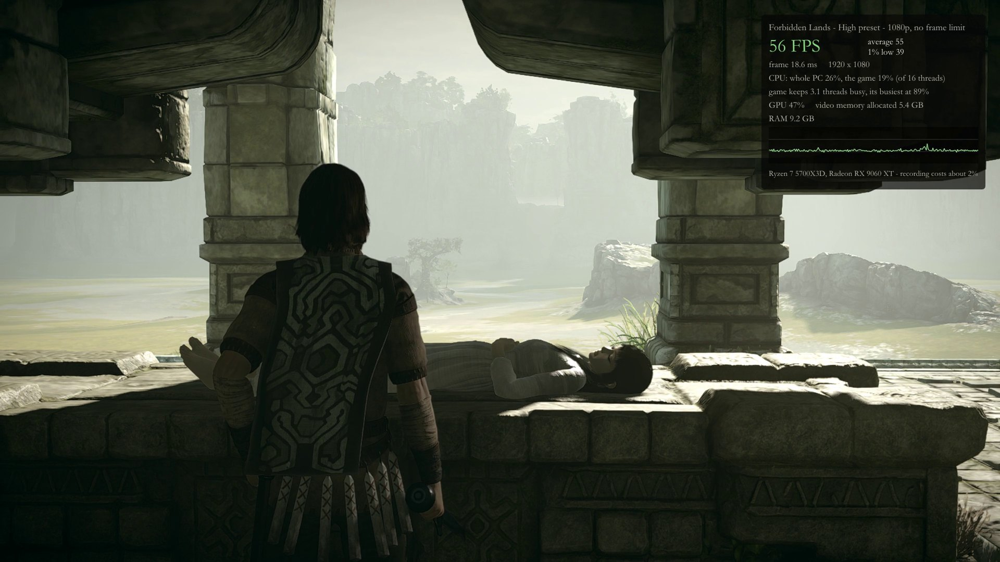

# Shadow of the Colossus (PS4, CUSA08809) on PC

Unofficial. Not affiliated with, endorsed by or connected to Sony Interactive Entertainment,
Bluepoint Games or the shadPS4 project.

This project starts one game, Shadow of the Colossus (2018, CUSA08809), from a single program
on Windows, with keyboard, mouse and controller support, PC graphics settings, an uncapped
frame rate, a free play mode and an achievements panel.

It has two parts:

- **This repository**: the scripts and settings around the program (build, install, settings
  pages, key pictures, test and measurement scripts).
- **The runtime**, a game-specific build of [shadPS4](https://github.com/shadps4-emu/shadPS4),
  a PlayStation 4 emulator. It lives in this repository too, on the branch
  [`runtime`](https://github.com/SotC-project/sotc-pc/tree/runtime), and is checked out into the
  `runtime` folder as a submodule.

It is not a recompilation or a decompilation. The game's own PlayStation 4 program runs
unchanged on the runtime, which translates its system and graphics calls to Windows and Vulkan.

**No game file is here and none may be added.** You need your own copy of the game.

## How it runs

Ryzen 7 5700X3D, Radeon RX 9060 XT, 1080p, frame rate uncapped. Average / 1% low FPS:

| Preset | Gaius arena | Field with Agro | Valus arena |
|---|---|---|---|
| Low | 77 / 40 | 114 / 63 | 89 / 45 |
| Medium | 61 / 34 | 80 / 39 | 73 / 42 |
| High | 59 / 22 | 106 / 55 | 74 / 28 |
| Ultra | 59 / 35 | 102 / 56 | 81 / 38 |





### Battles and scenes

High preset, 1080p, no frame limit, with the performance readout. Frames of the benchmark videos recorded 2026-10-11 (build 61ad3f5); the averages are over each 24 s recording.

<table>
<tr>
<td width="50%"><br>Pelagia, 12th colossus: average 74 FPS</td>
<td width="50%"><br>Phaedra, 4th colossus: average 93 FPS</td>
</tr>
<tr>
<td width="50%"><br>Gaius, 3rd colossus: average 57 FPS</td>
<td width="50%"><br>Malus, 16th colossus: average 63 FPS</td>
</tr>
<tr>
<td width="50%"><br>Basaran, 9th colossus, firing: average 78 FPS</td>
<td width="50%"><br>Dirge's desert: average 125 FPS</td>
</tr>
<tr>
<td width="50%"><br>Phalanx's desert: average 76 FPS</td>
<td width="50%"><br>Shrine of Worship: average 54 FPS</td>
</tr>
</table>

Method, the third scene and the requirements: [showcase/BENCHMARK.md](showcase/BENCHMARK.md).
Only this one PC has been measured; nothing has been run on Intel or NVIDIA graphics.

## How this works

The game is not rewritten. Its PlayStation 4 program file runs as it is, on a runtime that
stands in for the console:

- **The runtime is a custom build of [shadPS4](https://github.com/shadps4-emu/shadPS4)**, the
  open source PlayStation 4 emulator, licensed GPL-2.0-or-later like shadPS4 itself. It was
  branched from shadPS4 `main` at commit `945dbc3` (6 October 2026) and carries about a hundred
  commits on top, all on the branch
  [`runtime`](https://github.com/SotC-project/sotc-pc/tree/runtime). The emulator's general
  parts (loading the program, the system libraries, the translation of PS4 shaders and
  graphics commands to Vulkan) are shadPS4's work.
- **What this build changes** is aimed at this one game: fixes for the faults that stopped it
  from starting and rendering; work on frame rate and frame pacing (saved pipelines, parallel
  loading, fewer stalls); keyboard and mouse input mapped to the game's button schemes with
  matching key pictures; mouse use of the game's menus; lines added to the game's own menus
  (Settings, Free Play, Achievements, Quit); PC graphics options passed to the game's engine;
  achievements in place of trophies; and a start that goes straight into the game instead of
  an emulator front end.
- **This repository (the wrapper)** adds what surrounds the program: build and install
  scripts, the settings script, the default key layout, the generator for the key pictures,
  test and measurement scripts, and the documents.
- **You supply the game.** Nothing of the game is in either part: no program files, data,
  keys, pictures or sound.

It is one game on one runtime build, not a general emulator release, and nothing here is
offered to or endorsed by the shadPS4 project. For any other game use shadPS4 itself.

## Where to go

| You want to | Read |
|---|---|
| Build it and play | [docs/TUTORIAL.md](docs/TUTORIAL.md) |
| Report a problem or send a change | [CONTRIBUTING.md](CONTRIBUTING.md) |
| See how fast it runs and how it was measured | [showcase/BENCHMARK.md](showcase/BENCHMARK.md), [showcase/PERFORMANCE.md](showcase/PERFORMANCE.md) |
| Read the working notes | [showcase/NOTES.txt](showcase/NOTES.txt) |

## State

Playable from the title menu through colossus battles on the one PC it was made on. Treat it
as a test version:

- Tested on one PC only: Ryzen 7 5700X3D, Radeon RX 9060 XT 16 GB, 32 GB RAM, Windows 11.
  **Intel and NVIDIA graphics cards are untested.** Reports from other hardware are the most
  useful help you can give.
- Not every part of the game has been played through on it.
- Some sounds may still be off: the game's per-sound filters are now applied and loud sounds
  have headroom, but this is checked by measurement, not yet by ear.

## What you need

- Your own, legally obtained copy of the game, dumped from your own console.
- Windows 10 or 11 and a graphics card with Vulkan 1.3.
- To build: Visual Studio 2022 with CMake, Git, PowerShell 7 and the LLVM/Clang toolchain the
  `build*.bat` files point to.

## Quick start

```
git clone https://github.com/SotC-project/sotc-pc
cd sotc-pc
git submodule update --init runtime
git -C runtime submodule update --init --recursive
build-lto.bat
cd dist
pwsh -File Install.ps1 -GameDir "D:\Games\CUSA08809"
```

Then start "Shadow of the Colossus" from the desktop shortcut. Every step, the first start,
the controls and the settings are explained in [docs/TUTORIAL.md](docs/TUTORIAL.md).

## What is here

| Path | What it is |
|---|---|
| `build.bat`, `build-lto.bat`, `build-release.bat`, `build-pgo.bat` | Build the runtime (checked out in `runtime\`) |
| `dist\Install.ps1`, `Install.bat` | Copy the built program beside the scripts, create shortcuts |
| `dist\Settings.ps1` | Writes the graphics and display settings; run by Apply and Restart under Settings > Graphics in the game |
| `dist\FreePlay.ps1`, `Play.bat`, `PlayColossus.bat` | Start the game, or one colossus battle |
| `dist\glyphs.py`, `dist\glyphs\` | Draws the keyboard and Xbox button pictures that replace the PlayStation ones; the pictures are drawn by the script, not taken from the game |
| `dist\user\config.json`, `dist\user\input_config\` | Default settings and key bindings |
| `dist\ini_update.py` | Brings an older bindings file up to date |
| `cursor_art.py` | Draws the menu pointer (a stone arrowhead) into the runtime's source |
| `publish_filter.py` | The filter applied to the runtime before it is published |
| `test.sh`, `bossarena.sh`, `preptest.ps1`, `memwatch.ps1`, `freeplay_video.sh` and the other scripts | Scripted test runs, measurements and captures on a separate test profile |
| `showcase\BENCHMARK.md`, `PERFORMANCE.md`, `NOTES.txt` | Measurements and notes |
| `upstream\*.patch` | Two small general fixes kept apart from the game-specific work |

## What is not here

- Any file of the game: program, assets, saves, texture or memory dumps, trophy data.
- PlayStation system software, modules, keys or firmware.
- Shader and pipeline caches, logs, built programs, screenshots and video.
- The program icon used on the author's PC (it was drawn after another artist's work). The
  published runtime uses shadPS4's icon.

## Known limits

- One PC tested. A graphics driver reset (seen with a screen recorder running on AMD) closes the
  game with a message.
- Loading a new area can stall for a moment. Until 11 October 2026 a battle could begin with
  a stall of one to three seconds: four shaders ask for buffers of about 4 GB, and in one frame
  3 GB was bound and uploaded. Those requests are now held to 64 MB
  (`SOTC_UNBOUNDED_CAP_MB` sets another size, 0 none). What remains is texture upload under
  the loading screen: about half a second, once, during which the loading animation holds
  still. Measured over three minutes in two arenas: nothing over 90 ms once the scene was on
  screen, apart from one frame of 117 ms.
- The performance readout for benchmark footage (`SOTC_PERFHUD=1`) shows GPU load on Radeon
  cards only, from the driver. On the test PC Windows keeps no account of the game's work on
  the card, so on other makes the line appears only if Windows' own figure works there.
- Until 11 October 2026 the game faulted about once in nine returns to the title menu (14 times
  in 112 scripted runs). The cause was in the port: a read fault taken while Windows was
  re-making a mapping the game had partly unmapped was answered by copying old GPU buffer
  contents over the game's memory. With that corrected, 70 scripted runs of
  pause > Main Menu > Yes gave no fault (10 more on the release build). Should the game's own program fault for another
  reason, the port starts the game again and says so.

## Licence

The runtime is a derivative of shadPS4 and is licensed GPL-2.0-or-later, with shadPS4's
copyright notices kept. The scripts in this repository are under the same licence; see
`LICENSE`.
